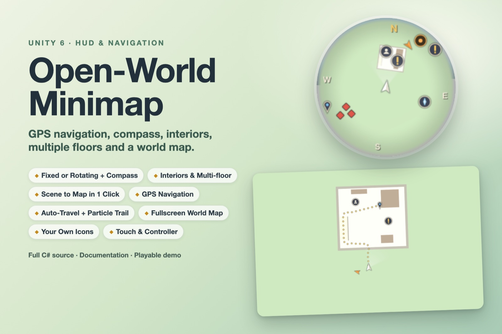
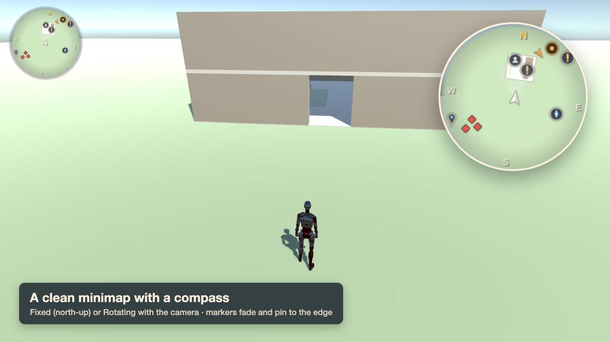
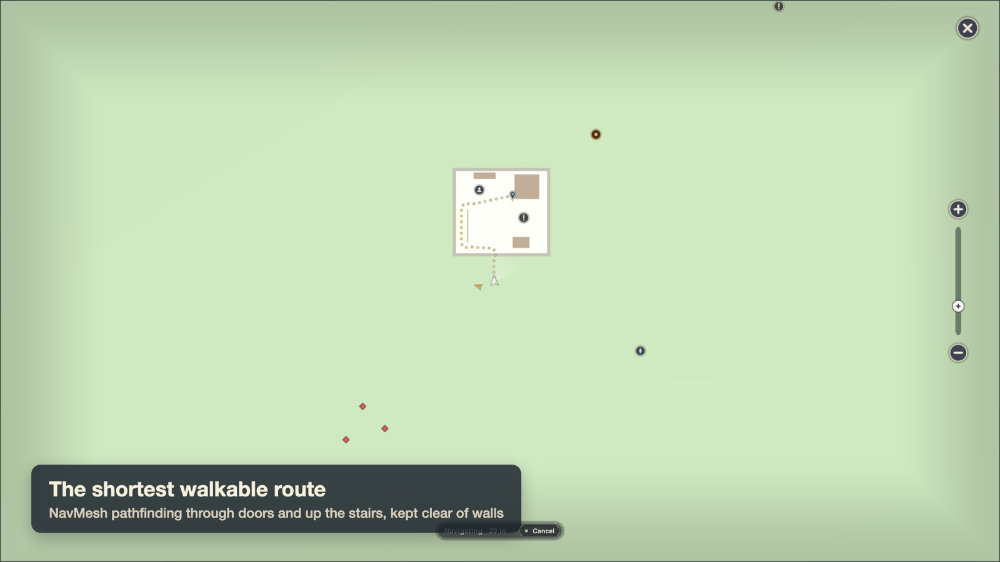
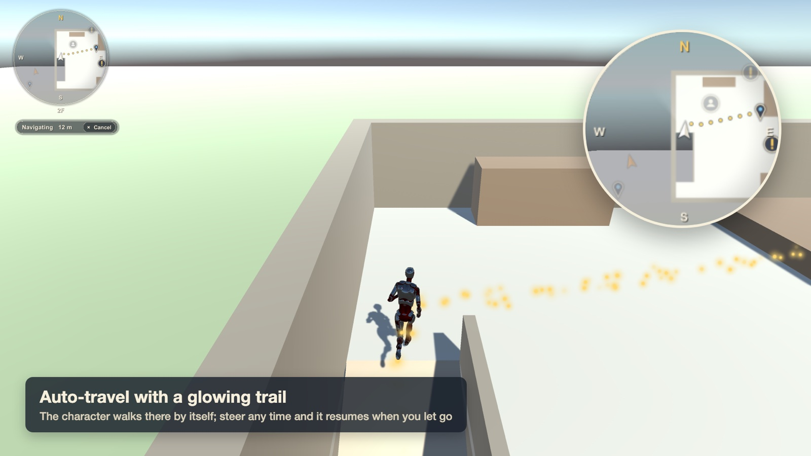
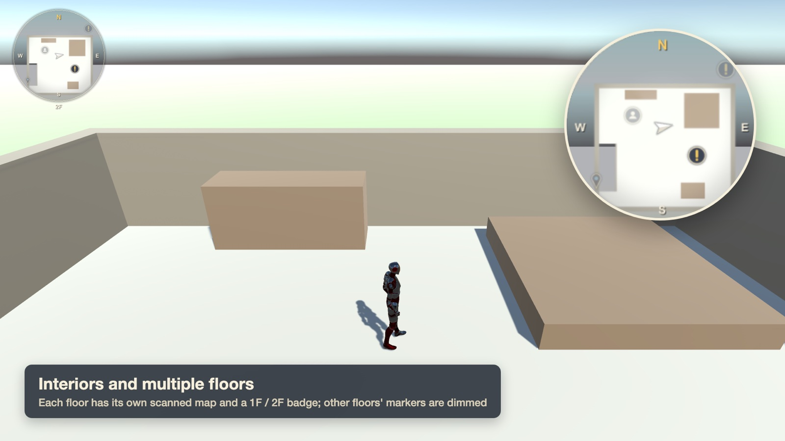

# Open-World Minimap: documentation

A complete minimap, world map and GPS navigation system for **Unity 6**, in **Built-in**, **URP** and **HDRP**.

📖 **Read the documentation website: https://jcafranca.github.io/open-world-minimap-docs/**

This repository holds the documentation only. The package itself is sold on the Unity Asset Store.

## Features

- 🧭 **Minimap**: circle, square or rectangle; north-up or rotating with the camera; compass; smooth zoom.
- 🗺️ **World map**: fullscreen, pan and zoom, a glowing find-me button, your coordinates, and sharp detail maps for towns, islands and floors. Closes with ×, Esc or a controller's B / ○.
- 📍 **GPS navigation**: click the map or any icon, then **Navigate**. The shortest NavMesh route flows along the map, follows stairs between floors and follows moving targets.
- 🏃 **Auto-travel**: the character walks the route behind a glowing trail; steer any time and it resumes when you let go.
- 📌 **Map pins**: Treasure, Danger, Home, Quest, Teleport and Pin, or your own types; saved between sessions.
- 🏠 **Interiors and floors**: each room or floor gets its own map and a 1F / 2F badge.
- 📸 **One-click scanner**: turns your level into a top-down map image, even kilometre-wide worlds with LODs and terrain trees.
- 📱 **Touch and controllers**: touch-sized controls, safe-area aware, works with either Input System.

## Set up in a minute

1. **GameObject → UI → Mini Map**
2. Set **World Bounds** to the area your level covers.
3. **Tools → Mini Map → Scan Scene Into Map Texture**
4. Press Play.

▶️ [Watch the setup tutorial](docs/assets/video/setup_tutorial.mp4) (73 s, every click shown, starting from an empty forest scene).

## Contents

| Page | |
|---|---|
| [Getting started](docs/getting-started.md) | Requirements, what's in the package, install, quick start |
| [Setup tutorial](docs/setup-tutorial.md) | From scratch, step by step, with the video |
| [The demo scene](docs/demo-scene.md) | Opening the demo, controls |
| [Map sources](docs/map-sources.md) | Scanning, your own map image, a live camera |
| [Minimap](docs/minimap.md) | Rotation, compass, shape, zoom |
| [Markers](docs/markers.md) | Marker types, your own icons and icon sets |
| [Interiors & floors](docs/interiors.md) | Per-room and per-floor maps |
| [World map](docs/world-map.md) | Fullscreen map, find-me button, coordinates |
| [GPS navigation](docs/gps-navigation.md) | Picking targets, routes, settings |
| [Map pins](docs/pins.md) | The Add a pin dialog, saving, removing |
| [Auto-travel & trail](docs/auto-travel.md) | Walking the route, manual takeover, the particle trail |
| [Mobile, touch & controllers](docs/mobile.md) | Touch sizing, safe area, controllers |
| [Component reference](docs/components.md) | Every component and editor menu |
| [Scripting API](docs/scripting-api.md) | Code examples |
| [Customising the art](docs/customising.md) | Replacing icons, frames and the arrow |
| [Performance](docs/performance.md) | What it costs per frame |
| [Troubleshooting](docs/troubleshooting.md) | Common problems and fixes |
| [Support & changelog](docs/changelog.md) | Getting help, release notes |

## Screenshots

| | |
|---|---|
|  |  |
|  |  |

## Support

Questions or bugs: [open an issue](https://github.com/jcafranca/open-world-minimap-docs/issues).
