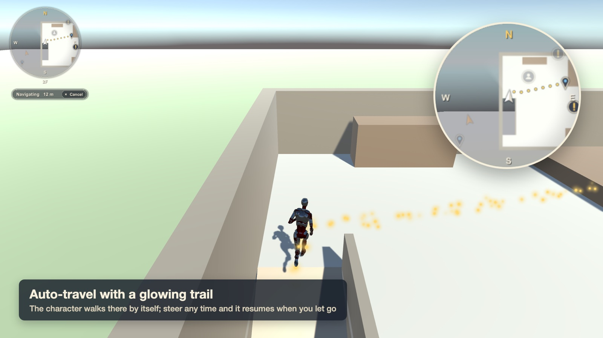

# Auto-travel and the particle trail



## Auto-travel

**MiniMapAutoTravel** (on the MiniMap, next to MiniMapGPS) walks the player to the destination when you press **Navigate**.

- It moves through the player's **CharacterController** when there is one, so walls still block. It moves in small steps, so even low frame rates can't make it cut corners.
- **Taking over:** call `PauseForManualControl()` every frame your player gives movement input. The player is then fully in control, and once they let go for **Resume Delay** (0.6 s), auto-travel continues if the destination isn't reached yet. **Resume After Manual** turns that off, and `Cancel()` stops auto-travel until the next destination.
- **Settings:** **Auto Travel**, **Move Speed**, **Turn Speed**, and an optional ground line (**Show World Line**, off by default).

```csharp
var travel = map.GetComponent<MiniMapAutoTravel>();

void Update()
{
    if (moveInput.sqrMagnitude > 0.01f)
        travel.PauseForManualControl(); // the player steers; auto-travel waits, then resumes
}
```

{: .note }
Character controllers that move the character every frame themselves (such as Starter Assets' ThirdPersonController) should be paused while auto-travel walks, or they'll fight it. The demo's **MiniMapDemoPlayer** shows one way: it disables the controller while `IsTraveling` is true and hands the camera back afterwards.

## The particle trail

**MiniMapNavTrail** (on the MiniMap, next to MiniMapGPS) shows the route in the world as soft glowing motes.

- They appear **Start Delay** (0.3 s) after navigation starts, with a **Start Burst** that lights the whole route at once, then keep appearing (**Emit Rate**).
- Motes the player has passed vanish within **Clear Fade**, and the trail clears on arrival.
- Other settings: **Color**, **Max Length**, **Particle Size**, **Lifetime**, **Height**, **Scatter**, **Rise**, **Particle Texture**.

## Watch it

<video src="assets/video/gameplay.mp4" controls muted playsinline width="100%"></video>

Walking, navigating, taking over mid-route, and auto-travel finishing the trip.
