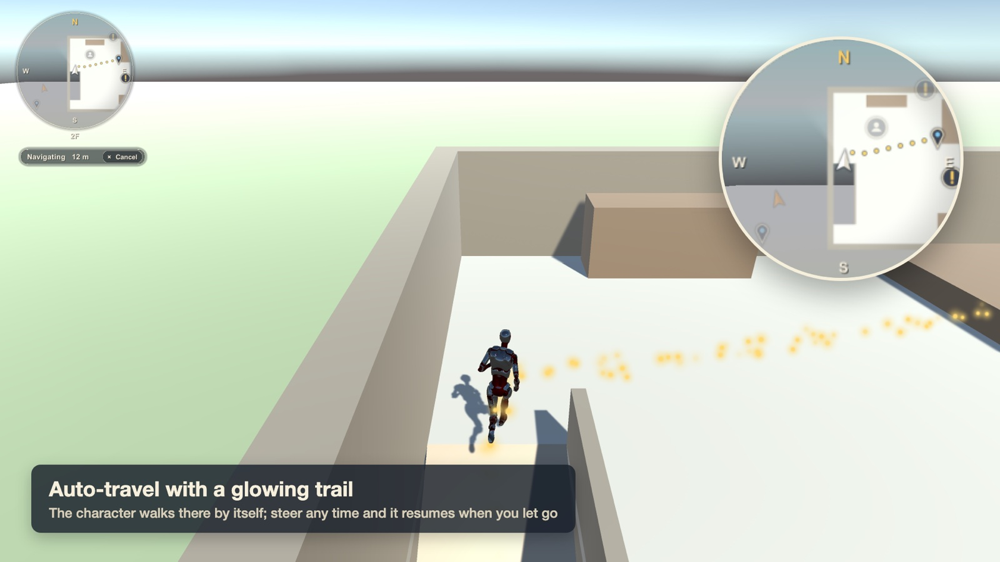

# The demo scene

The demo is a small level with a two-floor house, markers, a patrol cart and a NavMesh. It shows every feature, and its scripts are a reference for wiring the minimap to your own controller.

## Before you open it

1. Install **AI Navigation** (`com.unity.ai.navigation`) from the Package Manager. Without it the demo scripts are skipped automatically (no compile errors) and the minimap itself still works.
2. Import Unity's free **Starter Assets – Third Person** from the Asset Store. The demo's player is its character and camera. It brings the Input System and Cinemachine.

{: .warning }
On the **Built-in** pipeline, Starter Assets switches the project to URP when imported. To stay on Built-in, delete `Assets/Starter Assets/Editor/URPWizard` and set **Project Settings → Graphics → Default Render Pipeline** back to None.

Then open `Assets/MiniMap/Demo/MiniMapDemo.unity` and press Play.

Without Starter Assets, **Tools → Mini Map → Build Demo Scene** builds the same demo with a simple capsule player. In a **URP** or **HDRP** project, run that menu once as well: it rebuilds the demo with that pipeline's materials (the shipped demo uses Built-in materials).

## Controls

| Input | Action |
|---|---|
| Click the Game view | Capture the mouse (the mouse then turns the camera) |
| W A S D | Move (pauses auto-travel; it resumes when you let go) |
| Mouse | Turn the camera; in *Rotating* mode the map turns with it |
| Space / Shift | Jump / sprint (Starter Assets) |
| Tab | Switch rotation between Fixed and Rotating |
| − / = | Zoom the minimap |
| M, or click the minimap | Open the world map (close with ×, M or Esc) |
| C | Cycle the shape: circle → square → rectangle |
| Click the world map | Open **Add a pin**, or pick an icon, then press **Navigate** |
| Right-click | Remove a pin / clear the destination |
| Esc | Release the mouse, close the world map |

The demo camera looks down from high behind the character, and swings round behind it while auto-travel walks. Inside the house, everything above your floor is hidden (a cut-away based on the same MiniMapArea floors the minimap uses), so upper floors never block the view. Mouse-look speed is **Look Sensitivity** on the player's **MiniMapDemoPlayer**.

## What's demo-only

Everything built only for the demo sits under **Test Level (demo only)**: the ground, the house, test markers, the patrol cart and the NavMesh. Delete it freely. **Tools → Mini Map → Build Demo Scene** rebuilds the whole demo, including its map scans.

The demo scripts (`MiniMapUI.Demo` namespace) are examples, not part of the minimap:
- **MiniMapDemoPlayer**: keyboard shortcuts, mouse capture, the camera, handing control between the player and auto-travel.
- **MiniMapDemoBuilder** (editor): builds the demo level.
