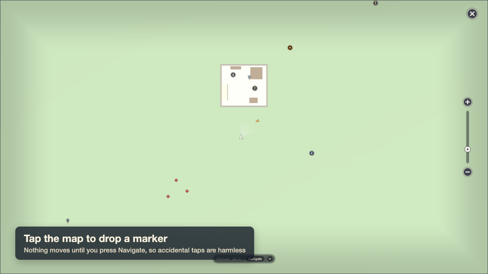
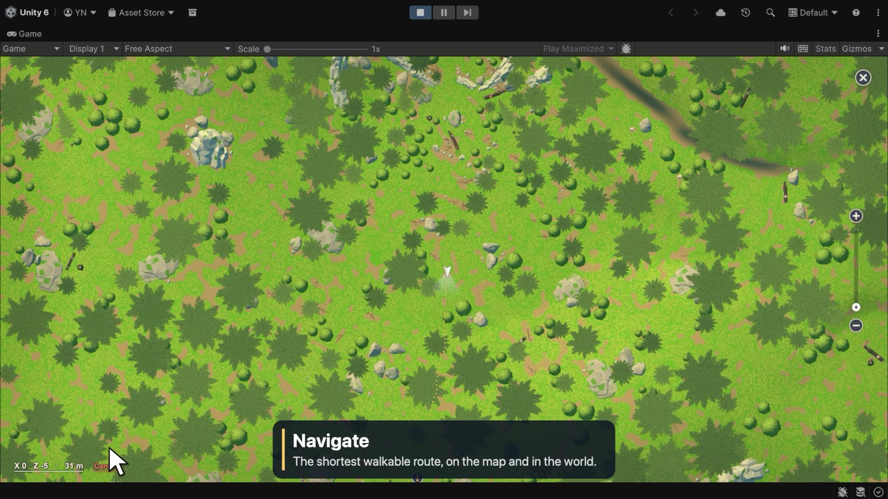

# GPS navigation
{: .no_toc }

1. TOC
{:toc}

---



## Setup

1. Add **MiniMapGPS** to the MiniMap object.
2. Bake a NavMesh for your level. With the **AI Navigation** package: add a **NavMesh Surface**, set **Use Geometry** (Physics Colliders ignores grass and leaves), and press **Bake**.
3. Optional: add **MiniMapPins** for the [Add a pin](pins.md) dialog, **MiniMapNavTrail** for the [particle trail](auto-travel.md#the-particle-trail), and **MiniMapAutoTravel** to [walk the route](auto-travel.md).

## How players use it

1. **Pick a target.**
   - **Click an icon** (a quest, an NPC, a teleport) to target that marker. If it moves (an NPC, a vehicle), the route follows it.
   - **Click empty ground** to drop a marker there. With **MiniMapPins**, the [Add a pin](pins.md) dialog opens instead.

   The bottom-left of the world map shows the coordinates and distance (**X 113  Z -243 · 34 m**) with **Navigate** and **Remove** links. Nothing moves yet, so a stray click is harmless.
2. **Press Navigate.** The shortest walkable route is drawn as flowing gold dots on the map and in the world. Under the minimap, an underlined line shows the destination's coordinates and the distance left.
3. **Go.** The route updates as the player moves, keeps a clearance from walls, follows stairs and ramps between floors, and clears when the player arrives. **Cancel** stops navigating.



If a clicked spot can't be reached (on furniture, behind a wall), the route goes to the closest reachable point and counts that as arrival. Without a NavMesh, the route falls back to a straight line (`RouteIsNavMesh` is false).

## Settings

| Setting | |
|---|---|
| **Click To Navigate** / **Confirm Before Navigating** | Turn off confirmation to start navigating straight away on click. |
| **Navigation Radius** | Extra clearance from walls and objects (default 0.4). In narrow doorways the route takes the middle. |
| **Agent Type ID** / **Area Mask** | Which NavMesh to plan on. Bake the agent at least as wide as your character's collider. |
| **Snap Distance** | How far from a clicked spot to look for walkable ground. |
| **Repath Interval** | How often the route is recalculated (default 0.25 s). |
| **Arrive Distance** / **Arrive Height** | How close counts as arrived. |
| **Route Color**, **Dot Size**, **Dot Spacing**, **Flow Speed**, **Dot Sprite** | The look of the route on the map. |
| **Show Destination Pin**, **Show Navigation Popup**, **Popup Text Color** | The pin in the world and the bottom-left popup. |
| **Show Coordinates** | The coordinates line under the minimap and on the world map. |

## From code

```csharp
var gps = map.GetComponent<MiniMapGPS>();
gps.MarkPoint(pos);           // what a click on the ground does
gps.MarkMarker(marker);       // what a click on an icon does
gps.NavigateToMarkedPoint();  // what Navigate does
gps.SetDestination(marker);   // navigate to a marker straight away; follows it if it moves
gps.SetDestination(pos);      // navigate to a point straight away
gps.ClearDestination();       // what Cancel does
float metresLeft = gps.RemainingDistance;
gps.Arrived += () => Debug.Log("Arrived");
```

See the [Scripting API](scripting-api.md) for everything.
