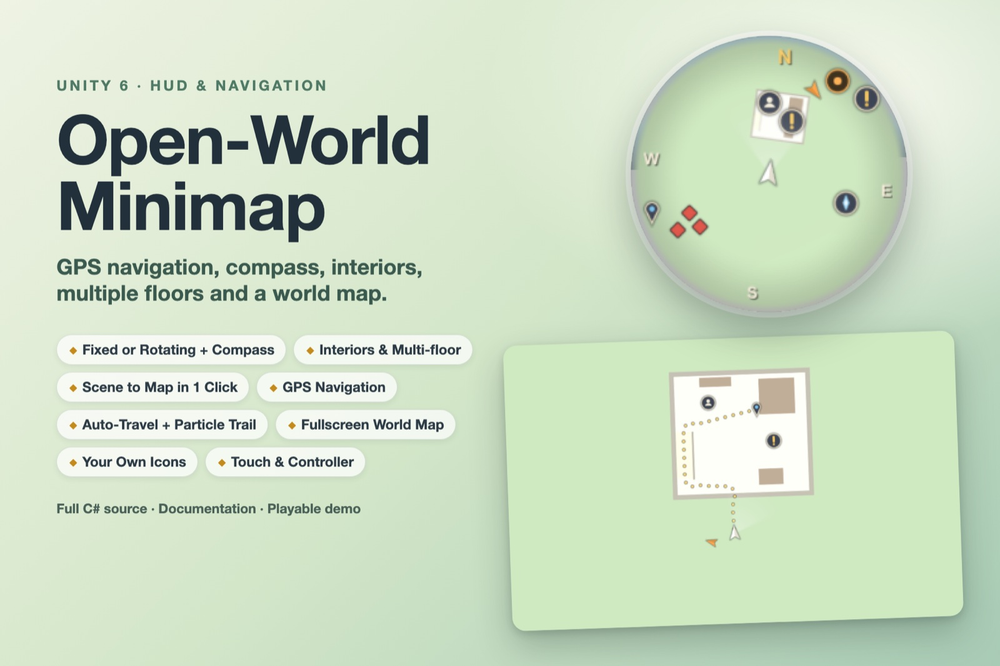
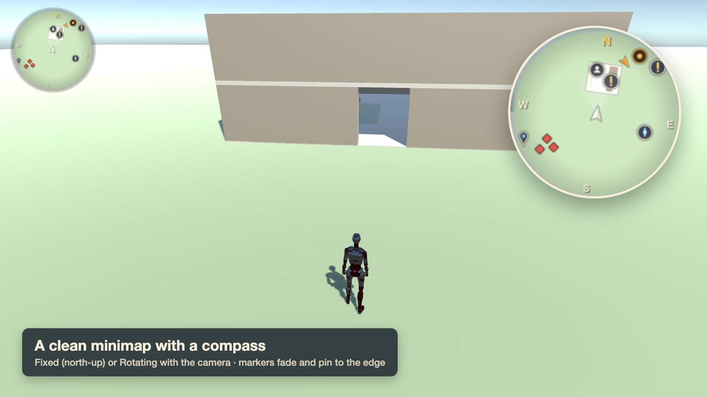
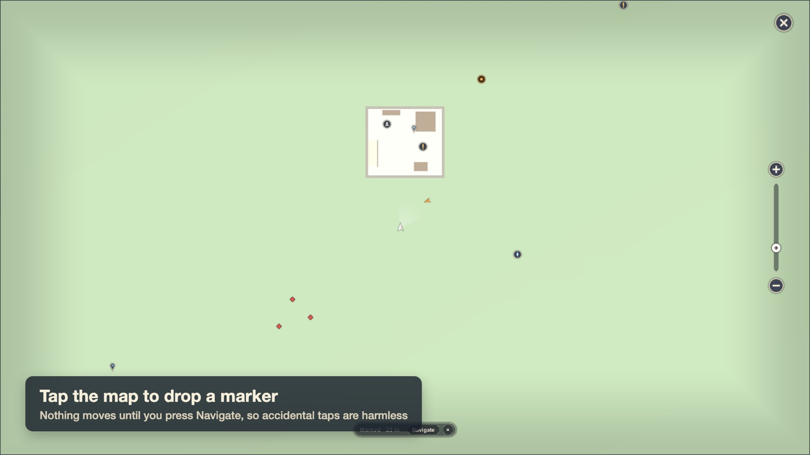
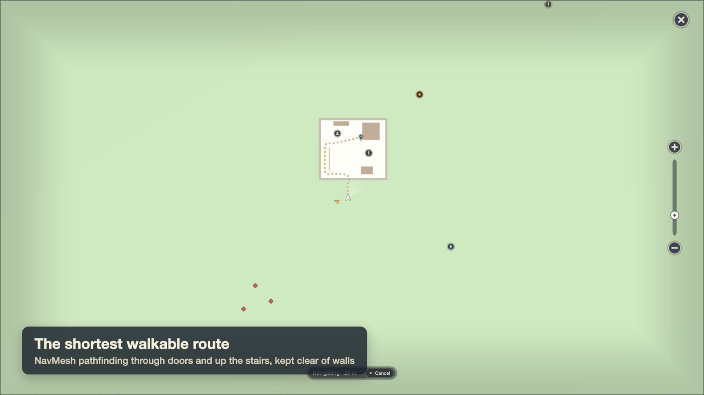
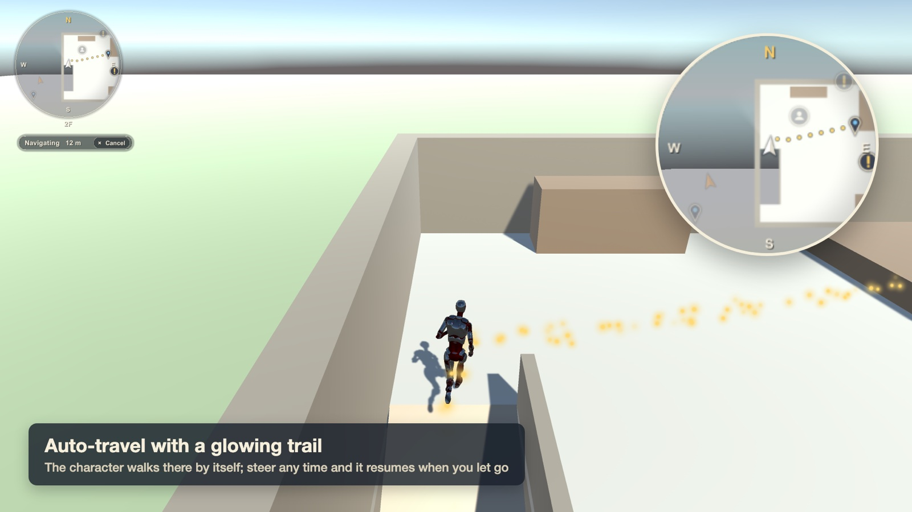
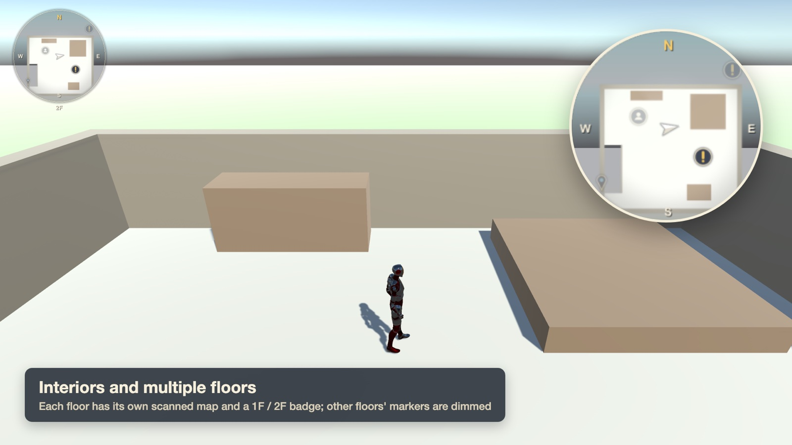
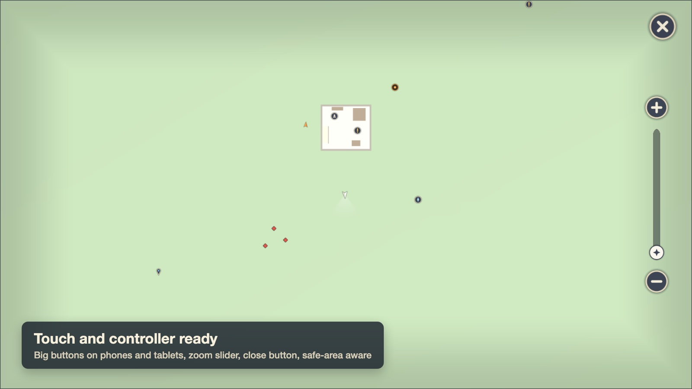

# Open-World Minimap
{: .fs-9 }

A complete minimap, world map and GPS navigation system for Unity 6, in Built-in, URP and HDRP.
{: .fs-6 .fw-300 }

[Get started](getting-started.md){: .btn .btn-primary .fs-5 .mb-4 .mb-md-0 .mr-2 }
[Watch the setup tutorial](setup-tutorial.md){: .btn .fs-5 .mb-4 .mb-md-0 }

---

## What it does

| | |
|---|---|
| 🧭 **Minimap** | Circle, square or rectangle, north-up or rotating with the camera, with a compass. Markers follow and turn with their objects, and quest markers stick to the edge when they're out of range. |
| 🗺️ **World map** | Fullscreen, with dragging, zooming, a glowing find-me button, your coordinates, and sharp detail maps for towns, islands and floors. Closes with ×, Esc or a controller's B / ○. |
| 📍 **GPS navigation** | Click the map or any icon, then press **Navigate**. The shortest walkable route (NavMesh) flows along the map, follows stairs between floors, keeps clear of walls and follows moving targets. |
| 🏃 **Auto-travel** | The character walks the route by itself, behind a glowing particle trail. Steer at any time, and it picks the route back up when you let go. |
| 📌 **Map pins** | Treasure, Danger, Home, Quest, Teleport and Pin, or your own types. Saved between sessions. |
| 🏠 **Interiors & floors** | Each room or floor gets its own map, with a 1F / 2F badge. Markers on other floors are dimmed. |
| 📸 **One-click scanner** | Turns your level into a top-down map image: buildings, trees, rocks and terrain, even in kilometre-wide worlds. |
| 📱 **Touch & controllers** | Touch-sized controls on phones and tablets, safe-area aware, and no dependency on either Input System. |

## Set up in a minute

1. **GameObject → UI → Mini Map**
2. Set **World Bounds** to the area your level covers.
3. **Tools → Mini Map → Scan Scene Into Map Texture**
4. Press Play.

The [setup tutorial](setup-tutorial.md) shows every click, starting from an empty forest scene.

<video src="assets/video/setup_tutorial.mp4" poster="assets/images/setup_01.jpg" controls muted playsinline width="100%"></video>

## Screenshots

| | |
|---|---|
|  |  |
|  |  |
|  |  |

## Where to next

- New to the package? Start with [Getting started](getting-started.md), then the [setup tutorial](setup-tutorial.md).
- Adding the map to an existing level: [Map sources](map-sources.md) and [Markers](markers.md).
- Navigation: [GPS navigation](gps-navigation.md), [Map pins](pins.md) and [Auto-travel](auto-travel.md).
- Writing code against it: [Scripting API](scripting-api.md).
