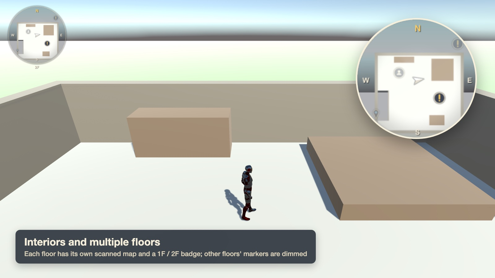

# Interiors and multi-floor buildings

Add a **MiniMapArea** to a GameObject with a collider (a Box Collider is easiest) around an interior. The collider becomes a trigger automatically, rotated colliders are supported, and no Rigidbody is needed. While the player is inside, the minimap fades over to that area's own map and zoom. Outside every area, it shows the world map.

## Settings

| Setting | |
|---|---|
| **Source** | *Texture* (a floor plan or a scan) or *Orthographic Camera* (live, looking down from the top of the box, so the roof is left out). |
| **Map Texture** | The floor-plan image. **Tools → Mini Map → Scan Scene Into Map Texture** with the area selected creates it. |
| **Camera Layers** | What the scan or live camera draws. |
| **Zoom** | World units from centre to edge while inside (default 12). |
| **Priority** | When areas overlap, the higher priority wins; on a tie, the smaller area wins (a room inside a house). |
| **Label** | `1F`, `2F`, `B1`… shown in a badge under the minimap. |

## Multiple floors

1. Stack one box per floor. Make each box run from that floor's surface up to just above its walls, and below the next floor's slab.
2. Select each box and run **Tools → Mini Map → Scan Scene Into Map Texture**. Every floor gets a map that leaves out the floors above.
3. Give each a **Label** (`1F`, `2F`…).

While inside, markers on other floors are dimmed (**Other Floor Alpha** on the MiniMap), and the badge shows which floor you're on (**Show Floor Label**).

The floor is checked **Floor Check Height** (default 0.5 m) above the player's pivot, so characters whose pivot is at their feet don't flicker between floors when standing right on a floor's edge.

GPS routes follow stairs and ramps between floors (see [GPS navigation](gps-navigation.md)).

## Sharp detail maps on the world map

A MiniMapArea's own scan is also drawn over its spot on the [world map](world-map.md), so zooming in on a town, an island or the floor you're on stays crisp even when the world scan covers kilometres. Use this for large worlds: scan the whole world for the world map, and add an area over the play space.
