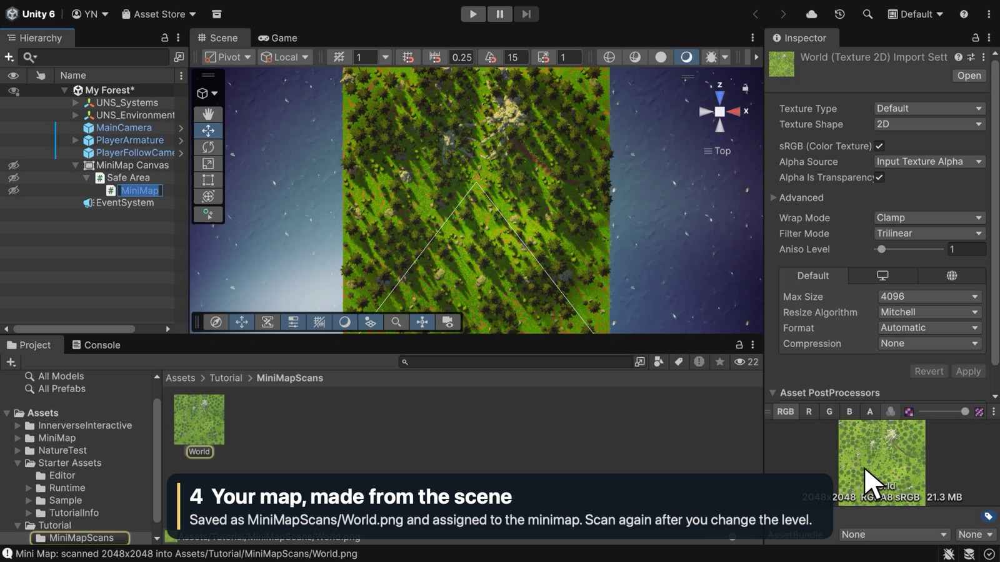
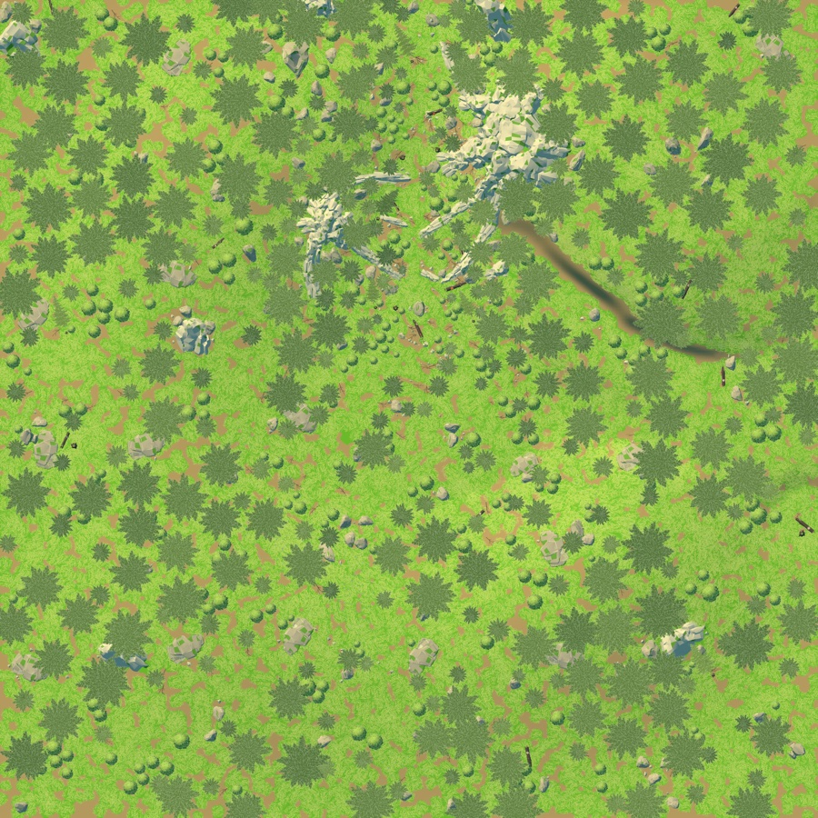
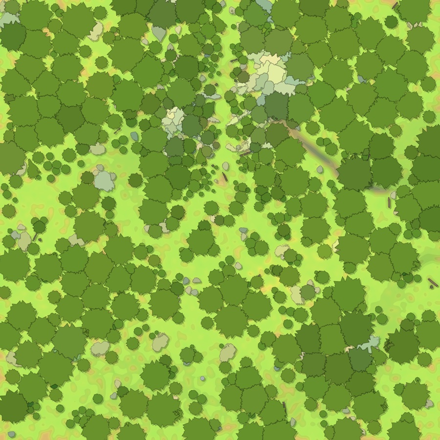
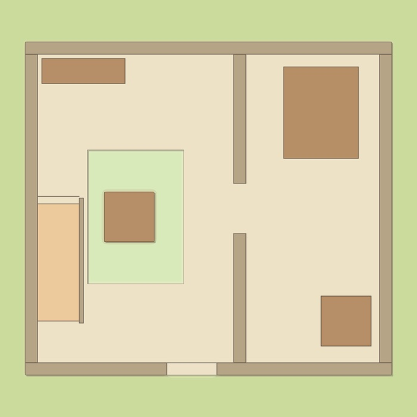

# Map sources
{: .no_toc }

The minimap needs an image of the world. There are three ways to give it one.

1. TOC
{:toc}

---

## a) Scan your scene (recommended)

Select the MiniMap and choose **Tools → Mini Map → Scan Scene Into Map Texture**. A top-down snapshot of everything inside **World Bounds** is saved as a PNG in a `MiniMapScans` folder next to your scene, and assigned as the map. Nothing is rendered again at runtime, so it costs nothing per frame.

- **Set World Bounds first**: the X/Z rectangle your level covers (X/Y is the south-west corner, W/H the size).
- **Camera Layers** chooses what's scanned. Leave out moving things such as players, NPCs and vehicles; they have their own icons.
- Fog is off for the scan and the camera looks straight down, so the image is clean and evenly lit.
- **Big worlds work too.** For the scan, every object draws at full detail (LOD groups don't drop trees, rocks or props that are tiny from above) and terrains draw all their trees. Your quality and terrain settings are put back afterwards.
- URP renderer features (such as SSAO) are switched off during the scan, so they can't tint the image.
- Anything outside the scanned geometry is transparent; the world map shows **World Map Backdrop** there.
- For a large world with a detailed play area (an island, a town), scan the world for the world map and add a [MiniMapArea](interiors.md) over the play area for a sharper map there.
- **Scan again after you change the level.**

### Scan style: Photo or Painted

**Scan Style** on the MiniMap (Map section) chooses the look of every scan, for the world and for areas.

| Photo | Painted |
|---|---|
|  |  |

- **Photo** (default): the scene as it renders, from above.
- **Painted**: a stylized map. Each object is filled with one flat colour taken from its own colours, with a soft darker outline and a small shadow. The ground is smoothed into flat paint, and water (the Water layer, or objects named water, lake, river, sea…) is lighter near the shore.
- Adjust **Painted Outline**, **Painted Shallow Water** and **Painted Deep Water**, then scan again.
- Grass, flowers, branches and other small ground cover blend into the ground. Terrain trees aren't outlined (they show as soft colour); trees placed as GameObjects are.
- If a render setup changes the scan's colours too much to tell objects apart, a Photo scan is saved instead, with a warning in the Console.

### Scanning an area or floor

Select a **MiniMapArea** instead of the MiniMap and run the same menu: it scans just that box, from its top down, so the roof is left out. See [Interiors & floors](interiors.md).

## b) Your own illustrated map

Set **Source** to *Texture*, assign **Map Texture**, and set **World Bounds** to the X/Z area the image covers. The top of the image is +Z (north). A sample illustrated island is included in `Assets/MiniMap/Sample/SampleMap.png`.

## c) Live camera

Set **Source** to *Orthographic Camera*. A north-up orthographic camera follows the player and renders **Camera Layers** into a RenderTexture (**Render Texture Size**) every frame. Use this when the map must show moving geometry. It costs one extra camera render per frame.

{: .tip }
The minimap shows your scene's real colours when scanned or rendered live. For a painted look, use simple flat-coloured materials on a dedicated minimap layer, or an illustrated texture.
