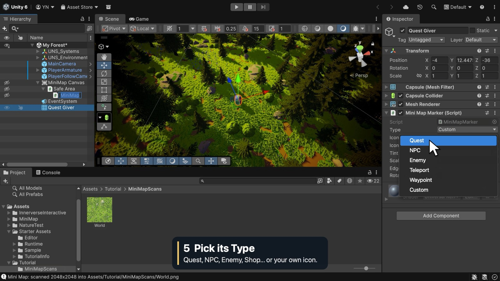

# Markers
{: .no_toc }

Add **MiniMapMarker** to any GameObject to show it on the minimap and the world map.

1. TOC
{:toc}

---

## Settings

| Setting | |
|---|---|
| **Type** | Quest, NPC, Enemy, Teleport, Waypoint or Custom. Each has a built-in icon. |
| **Icon** | Optional: your own sprite for this marker. It overrides everything else. |
| **Icon Name** | Optional: the name of an icon in the MiniMap's **Icon Set** (for example "Chest"). |
| **Tint** | Recolours the icon. The Custom icon is white, so it takes any tint. |
| **Scale** | Size multiplier. |
| **Edge** | *Auto*: quests and waypoints stick to the rim when out of range, and everything else fades out. *Clamp To Edge* / *Hide* force one behaviour. |
| **Rotate With Object** | Turns the icon with the object's facing, for vehicles, patrols or other players. Use an icon that points up. |

Icons follow their objects every frame, fade in and out smoothly, and quest icons pulse gently. On the world map, click any icon to target it with [GPS](gps-navigation.md).

## Your own icons and styles

- **Icon Sets:** choose **Assets → Create → Mini Map → Icon Set**. Add entries with a **Name**, **Sprite**, **Tint** and **Scale** (for example "Chest", "Shop", "Boss"). Assign the set to the MiniMap's **Icon Set** field, then set a marker's **Icon Name** to use one. You aren't limited to the six built-in types.
- **Replace a built-in type:** an entry named after a type (`Quest`, `NPC`, `Enemy`, `Teleport`, `Waypoint`, `Custom`) replaces that type's icon for every marker of that type.
- **Switch styles at runtime:** assign a different Icon Set (`map.iconSet = nightIcons;`) and every icon updates at once. Useful for a settings menu or colour-blind friendly icons.
- **Icons from images:** `marker.SetIcon(texture)` uses any `Texture2D` as the icon, such as a picture the player chooses or downloads.
- **Player arrow and view cone:** assign new sprites to **Player Arrow** / **View Cone** at any time, even while playing. Clear them for the built-in art.

### Which icon wins

The marker's **Icon** → its **Icon Name** in the Icon Set → an Icon Set entry named after its type → **Marker Icons** for its type (built-in art by default). `map.ResolveIcon(marker, out tint, out scale)` tells you which icon a marker will show.

### Importing icons

Drop a PNG into the project, set **Texture Type** to **Sprite (2D and UI)**, and use 64–128 px with transparent edges. Icons that point up work best with **Rotate With Object**.
