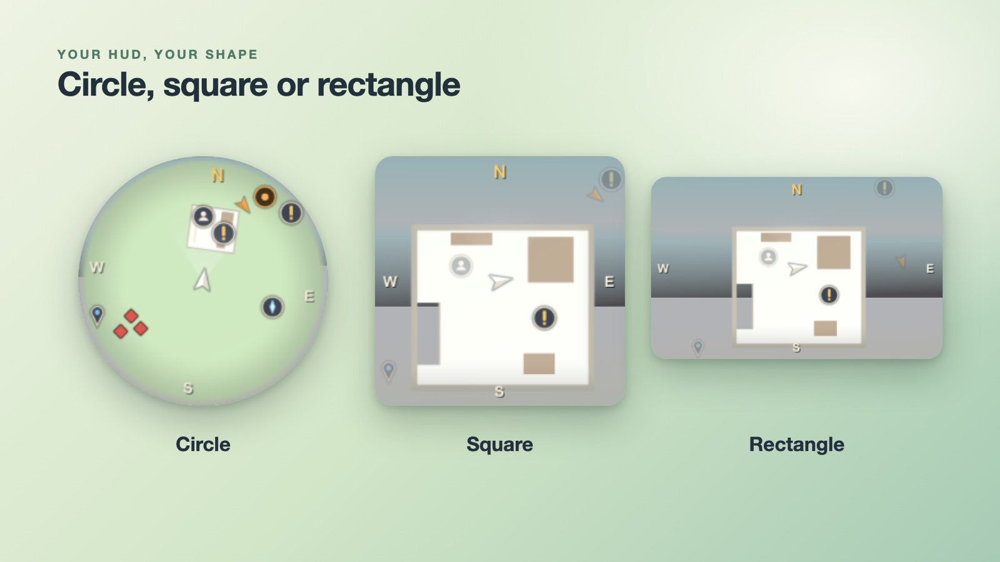

# Minimap: rotation, compass, shape and zoom

All of these are on the **MiniMap** component.

## Rotation

In the **Tracking** section:
- **Fixed** (default): north stays up, and the player arrow turns.
- **Rotating**: the map turns with the **Heading Source** (usually the camera), so what's ahead is always up. Leave Heading Source empty to follow the player's facing instead.

Switching between the two eases smoothly (**Rotation Smooth Time**). At runtime, set `rotation` or call `ToggleRotation()`.

## Compass

N/E/S/W letters ride just inside the edge and move as the map turns, with N in gold. Options: **Show Compass**, **Compass Font**, **Compass Color**, **North Color**.

## Shape

**Circle** or **Square** (both sized by **Diameter**), or **Rectangle** (**Rectangle Size**). Square and Rectangle use **Corner Radius**. The shape can change at runtime; the edge softness, inner shading and rim adapt automatically.

## Layout

**Margin** (distance from the top-left corner), **Icon Size** and **Edge Softness**, all in reference pixels on the 1920×1080 canvas.

## Zoom

**Zoom** is the number of world units from the centre to the top edge, smoothed and clamped to **Min/Max Zoom**. Call `ZoomBy(0.8f)` to zoom in from code (below 1 zooms in).

## Under the minimap

With a destination set, an underlined line under the minimap shows the destination's coordinates and the distance (**X 120  Z -248 · 26 m**). Turn it off with **Show Coordinates** on MiniMapGPS.

## Floor badge

Inside a [MiniMapArea](interiors.md) with a **Label**, a badge such as **1F** or **2F** shows under the minimap (**Show Floor Label**).
