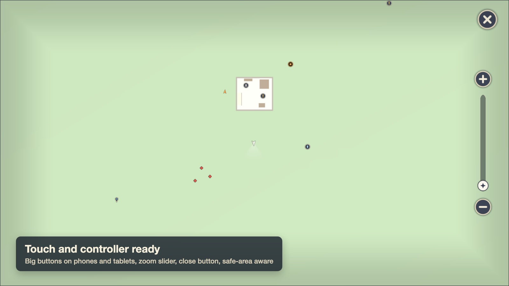

# Mobile, touch and controllers

- **Safe area:** the HUD stays inside the screen's safe area (notches, rounded corners), through the **SafeAreaFitter** on the Safe Area object.
- **Touch sizing:** on phones and tablets, the world-map buttons, zoom slider, popup and pin dialog become touch-sized automatically. **Control Size** is *Auto*, *Desktop* or *Touch*, and **Touch Control Scale** sets how big (default 1.75×). Set *Touch* to preview it in the editor.
- **Touch:** tap the minimap to open the world map, drag to pan, use + / − or the slider to zoom, tap to pick a spot or an icon, and tap **Navigate**.
- **Controllers:** when the world map opens, its × button is selected, so the controller's confirm or cancel button closes it, and **B / ○** closes it too. The popup, slider and buttons are standard uGUI selectables, so they work with EventSystem navigation.
- **No input dependency:** your game calls the API (`ToggleWorldMap()`, `ZoomBy()`, `ToggleRotation()`, `PauseForManualControl()`…) from whatever input system it uses. The old Input Manager and the new Input System both work.
