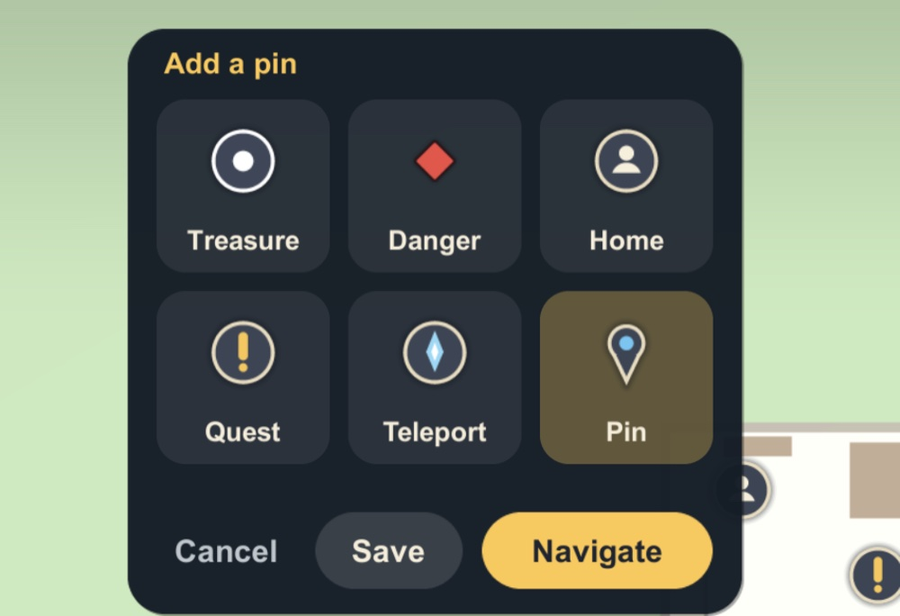

# Map pins

Add **MiniMapPins** to the MiniMap (next to MiniMapGPS). Clicking empty ground on the world map then opens **Add a pin**.



1. Pick a type: **Treasure**, **Danger**, **Home**, **Quest**, **Teleport** or **Pin**.
2. Press **Save** to keep the pin on the map, or **Navigate** to save it and start a route there. **Cancel** (or Esc) closes the dialog.

Pins are saved between sessions and drawn a little bigger than other markers.

## Removing pins

- Click a pin on the world map, then press **Remove** at the bottom-left.
- Or right-click it.

The level's own markers (quests, NPCs, waypoints) can't be deleted by players: for them the link says **Clear**, and only deselects.

## Settings

| Setting | |
|---|---|
| **Types** | The list in the dialog. Each type has a **Name**, a **Built In Icon** (or your own **Icon** sprite) and a **Tint**. Add, remove or reorder freely. |
| **Pin Scale** | Size of pins compared with other markers (default 1.4). |
| **Save Pins** | Keep pins between sessions (stored in PlayerPrefs). |
| **Save Key** | Use different keys for different save slots or levels. |

## From code

```csharp
var pins = map.GetComponent<MiniMapPins>();
MiniMapMarker pin = pins.AddPin(0, worldPosition); // type index into Types
pins.RemovePin(pin);
pins.RemoveAllPins();
foreach (var p in pins.Pins) { /* ... */ }
bool mine = pins.IsPin(marker);
```
