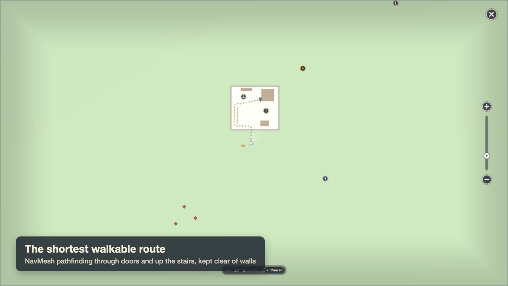

# World map (fullscreen)

The same map opens fullscreen and north-up, with every marker and the player.

| | |
|---|---|
| **Open** | Click or tap the minimap (**Minimap Click Opens World Map**), or call `OpenWorldMap()` / `ToggleWorldMap()`. |
| **Close** | The **×** button at the top-right, **Esc**, a controller's **B / ○**, or `CloseWorldMap()`. Esc closes the pin dialog first if it's open (**Escape Closes World Map**). |
| **Pan** | Drag. |
| **Zoom** | Scroll, the **+ / −** buttons, or the vertical zoom slider. |
| **Edges** | With a texture map, the view never goes past the map's edge. Zooming out stops when the map fills the screen, and panning stops at the edges. |

## Find yourself

When you've panned or zoomed so your character is off-screen, a glowing crosshair button appears near the map's border, on the side where you are (top if you're north, and so on). Click it and the map glides back to you (`CenterWorldMapOnPlayer()`).

## Your position

The bottom-left always shows your coordinates (**X 113  Z -243**). With a marked point or destination, it adds the distance and the **Navigate**, **Remove** and **Cancel** links (see [GPS navigation](gps-navigation.md)). Turn the line off with **Show Coordinates** on MiniMapGPS.

## Sharp areas

A [MiniMapArea](interiors.md)'s own scan (a town, an island, the floor you're on) is drawn over its spot, so zooming in stays crisp even when the world scan covers kilometres. It uses the area you're in, or else the one in the middle of the view.

## Settings (on MiniMap)

| Setting | |
|---|---|
| **World Map Zoom** | Starting zoom: world units from the centre to the top edge. |
| **World Map Min / Max Zoom** | Zoom limits (min 8 lets you zoom right in). |
| **World Map Icon Scale** | Icons are bigger on the world map (default 1.6×). |
| **Show Zoom Slider** | The vertical slider on the right. |
| **World Map Backdrop** | The colour around and under the map. |
| **Minimap Click Opens World Map**, **Escape Closes World Map** | |
